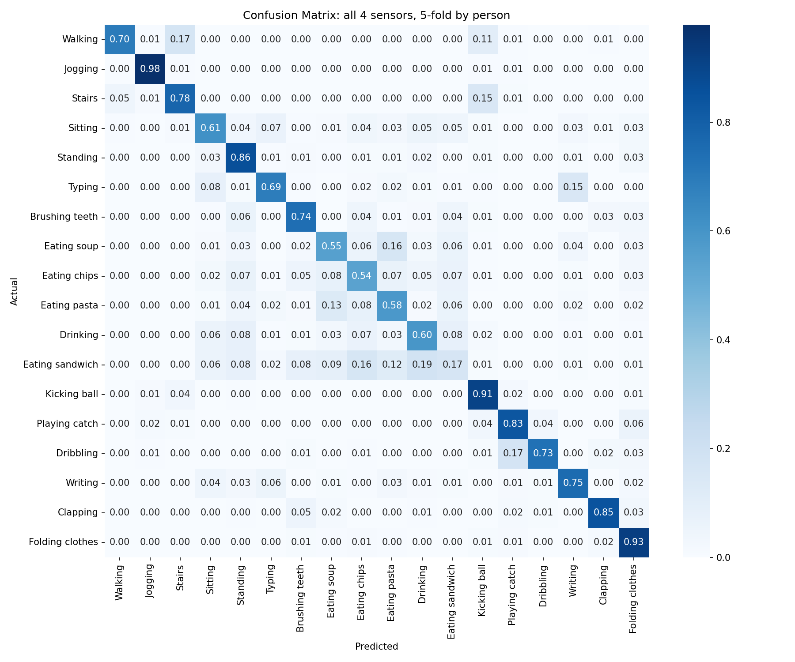
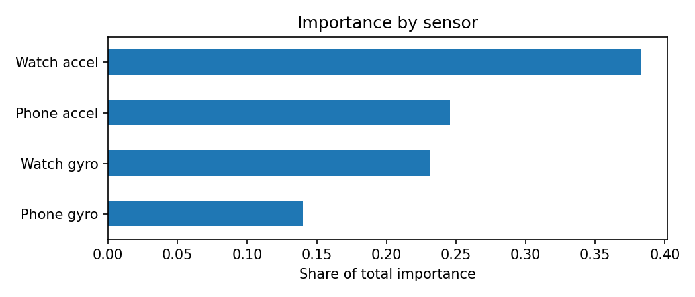

# Human Activity Recognition (Smartphone + Smartwatch)

Classifying 18 daily activities from accelerometer and gyroscope data
recorded on a phone and a watch.

## Dataset
WISDM Smartphone and Smartwatch Activity and Biometrics Dataset
(UCI Machine Learning Repository). 50 subjects, 18 activities,
4 sensors: phone accel, phone gyro, watch accel, watch gyro.
Download it from the UCI page. It is not included in this repo.

## Approach
1. Loaded the pre-computed ARFF feature files (91 features per sensor)
   for all 50 subjects.
2. Merged the four sensors into one table (364 features, 15,803 windows).
3. Evaluated with 5-fold cross-validation grouped by subject, so the
   model is always tested on people it has never seen.
4. Models: Random Forest and Extra Trees (tree ensembles). Random Forest
   was used for the first experiments on phone accelerometer data
   (38.0% with subject-wise CV). Extra Trees gave a similar score
   (37.1%) and trained faster, so it was used for the multi-sensor
   comparison and tuning.

## Results (accuracy on unseen subjects)
| Sensors | Accuracy |
|---|---|
| Phone accel only | 37.8% |
| Phone accel + gyro | 39.4% |
| Watch accel + gyro | 68.3% |
| All four sensors | 71.2% |

Random guessing on 18 classes is about 5.6%.




## Key finding: data leakage
A random train/test split on phone accelerometer data gave 86.4%
accuracy, but windows from the same person were in both sets.
Splitting by subject dropped the score to about 32% on a single split
(38% with cross-validation). Subject-wise evaluation is the honest number.

## Findings
- Watch data helps most: hand activities (typing, writing, brushing
  teeth) are poorly captured by a phone in a pocket.
- Best classes: jogging, folding clothes, kicking a ball.
- Weakest: eating sandwich (17%). The eating activities are confused
  with each other.

## Hyperparameter tuning
Randomized search (8 candidates, 4-fold CV grouped by subject) on 40
subjects, evaluated once on 10 held-out subjects.
Baseline: [X]% -> Tuned: [Y]%. Best settings: [paste best_params_].

## Limitations
- The ARFF files have no timestamps, so windows from the four sensors
  were matched by their order within each subject and activity. This is
  an approximation and may misalign some windows.
- Only windows present in all four sensors were kept (15,803 of
  23,074 phone-accel windows).
- The held-out test uses only 10 subjects, so small differences may be noise.

## How to run
```
pip install -r requirements.txt
jupyter notebook
```
Set the folder paths in the notebook to where you saved the ARFF files.

## Credit
Dataset: WISDM Lab, Fordham University (UCI Machine Learning Repository).
Add the exact citation from the UCI dataset page here.
